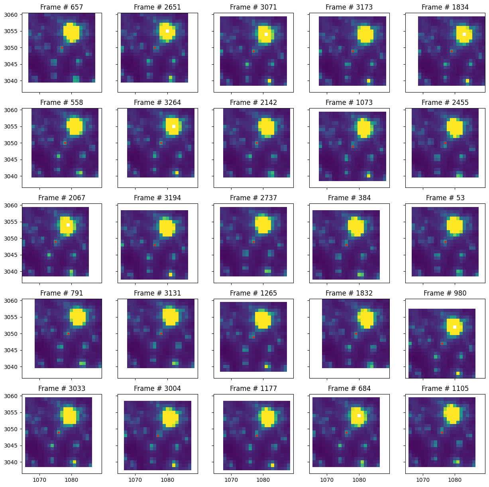
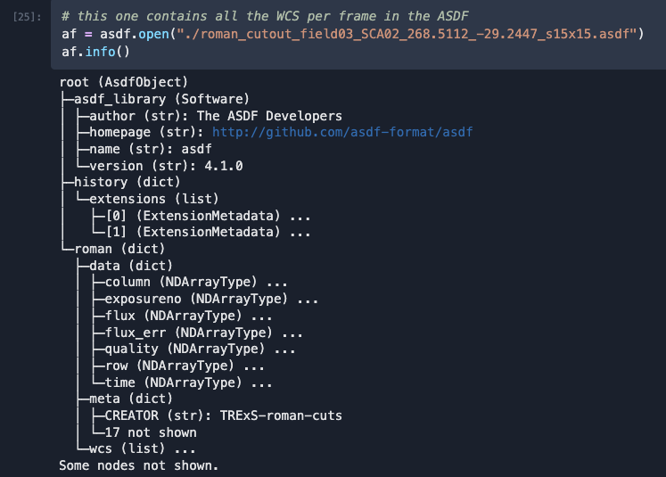

[](https://pypi.org/project/roman-cuts)
[](https://github.com/jorgemarpa/roman-cuts/actions/workflows/pytest.yaml/) [](https://github.com/jorgemarpa/roman-cuts/actions/workflows/mypy.yaml) [](https://github.com/jorgemarpa/roman-cuts/actions/workflows/ruff.yaml)[](https://github.com/jorgemarpa/roman-cuts/actions/workflows/deploy-mkdocs.yaml)

# Roman-cuts

Package to create image cutouts from simulations made with `RImTimSim` or from Roman Commissioning activities

## Install

Easy install with pip from your local clone of the repository
```bash
pip install -e .           # sim only (no cloud/MAST deps)
```
To use the tools with commissioning data, checkout this branch (`romcom`) and then run
```bash
pip install -e ".[com]"    # sim + com (all features)
```

## Usage

### Simulated images

For more details check out the notebook tutorial [here](./notebooks/tutorial-sim.ipynb).

```python
from roman_cuts import RomanCuts

# make a list of your local FITS files
fl = paths to local FITS files

rcube = RomanCuts(field=3, sca=1, filter="F146", file_list=fl)

# using sky coord coordinates
radec = (268.461687, -29.232092)
rcube.make_cutout(radec=radec, size=(21, 21), dithered=True)

# or using rowcol pixel coordinates
rowcol = (256, 256)
rcube.make_cutout(rowcol=rowcol, size=(11, 11), dithered=False)

# we can save to disk, default is ASDF
rcube.save_cutout()
```

### ROMCOM data

See the tutorial [here](./notebooks/tutorial-com.ipynb).

## Examples
The figure shows a sequence of 21x21 pixel cutouts taken from the FFI simulations 
centered on the target RA, Decl = (268.5112137932491, -29.24473947250156).
This account for dithered observations



The data is saved into a ASDF file as shown below:

