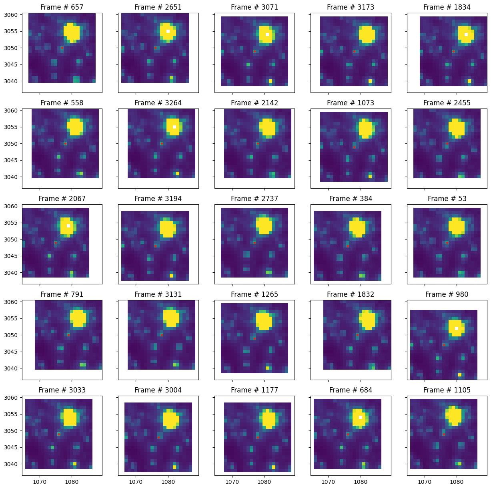
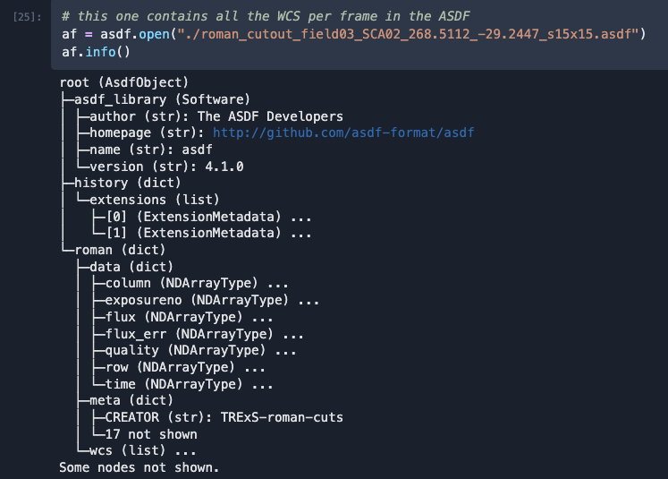

[](https://pypi.org/project/roman-cuts)
[](https://github.com/jorgemarpa/roman-cuts/actions/workflows/pytest.yaml)
[](https://github.com/jorgemarpa/roman-cuts/actions/workflows/mypy.yaml)
[](https://github.com/jorgemarpa/roman-cuts/actions/workflows/ruff.yaml)
[](https://github.com/jorgemarpa/roman-cuts/actions/workflows/deploy-mkdocs.yaml)

# roman-cuts

`roman-cuts` is a Python package designed to extract target-centered time-series image cutouts from observations taken with the **Nancy Grace Roman Space Telescope Wide Field Instrument (WFI)**. It provides unified support for both simulated images (such as synthetic full-frame images generated with `RImTimSim`) and real Roman science data products accessed through the Mikulski Archive for Space Telescopes (MAST).

---

## About NASA Roman & the Galactic Bulge Time Domain Survey

The **Nancy Grace Roman Space Telescope** is NASA's new flagship observatory, engineered to explore the infrared universe with unprecedented speed and precision. Its primary imaging camera, the **Wide Field Instrument (WFI)**, combines 18 Sensor Chip Assemblies (SCAs) totaling 300 megapixels to yield a 0.281 deg² field of view—roughly 100 times that of the Hubble Space Telescope at comparable resolution (0.11 arcsec/pixel).

A cornerstone community initiative of Roman is the **Galactic Bulge Time Domain Survey (GBTDS)**. By continuously monitoring ~2 square degrees in the dense, dust-obscured Milky Way bulge with ~12-minute sampling over six 62-day seasons in the near-infrared, the GBTDS will detect tens of thousands of exoplanets via the transiting method, discover stellar oscillations, and measure billions of stellar positions.

### The TRExS Project: Transits in the Roman Galactic EXoplanet Survey

**TRExS** ([Transits in the Roman Galactic EXoplanet Survey](https://www.stsci.edu/contents/events/roman/2023/november/transits-in-the-roman-galactic-exoplanet-survey-trexs)) is a Wide Field Science initiative and a Roman Cycle 1 designed to maximize the transit science return from Roman's GBTDS. While the GBTDS is nominally optimized for gravitational microlensing, its high-cadence time-series imaging of hundreds of millions of stars toward the Galactic Center makes it one of the most powerful transiting exoplanet surveys ever conceived.

Key pillars of TRExS include:
- **Massive Exoplanet Yields:** TRExS is predicted to discover between **~100,000 transiting exoplanets**, expanding the catalog of known exoplanets by orders of magnitude compared to Kepler and TESS.
- **Statistical Demographics of Rare Systems:** The enormous sample size places stringent demographic constraints on intrinsically rare planetary architectures, ultra-short-period planets, planets orbiting evolved or giant stars, and brown dwarf companions.
- **Galactic Depth & Diversity:** Probing deep through the Galactic disk into the inner bulge, TRExS observes stars across diverse stellar populations, metallicities, and Galactic environments, mapping how planet occurrence varies throughout the Milky Way.
- **Near-Infrared Atmospheres:** Leveraging Roman's near-infrared bandpass (WFI F146 and companion filters), TRExS enables direct atmospheric detection and thermal emission measurements (e.g., secondary eclipses and phase curves) for thousands of transiting giant planets at a population level.
- **Survey Synergy:** By pairing transit discoveries with microlensing detections in the same survey footprint, Roman and TRExS will establish a unified census of planetary systems spanning orbital separations from <0.1 AU out to free-floating planets.

Within the TRExS pipeline, `roman-cuts` serves as the primary data extraction layer, preparing target cutout cubes from full-frame images and cloud archives for downstream effective PSF (ePSF) modeling and precision light curve extraction.

---

## Installation

`roman-cuts` requires Python ≥ 3.11.

### User Installation with `pip`

Install the standard release (simulation module):

```bash
pip install roman-cuts
```

To install with Roman Commissioning (`com`) support—including cloud access, MAST archive queries, and Roman datamodels:

```bash
pip install "roman-cuts[com]"
```

Or install from a local repository clone:

```bash
git clone https://github.com/jorgemarpa/roman-cuts.git
cd roman-cuts
pip install -e ".[com]"
```

### Development Installation with `uv`

We recommend [uv](https://docs.astral.sh/uv/) for fast, deterministic development environments:

```bash
# Clone the repository
git clone https://github.com/jorgemarpa/roman-cuts.git
cd roman-cuts

# Create virtual environment and install all dependencies (including dev and com extras)
uv sync --all-extras

# Run tests
uv run pytest -v

# Run linting and type checking
uv run ruff check .
uv run mypy src/

# Build and preview documentation locally
uv run mkdocs serve
```

---

## Quickstart Guide

`roman-cuts` provides two primary modules:
1. `roman_cuts.sim`: For simulated FITS images produced by `RImTimSim` or synthetic pipeline runs.
2. `roman_cuts.com`: For Roman Commissioning and archive observations queried from MAST or local ASDF/FITS L2 calibrated files.

### 1. Simulated Images (`roman_cuts.sim`)

The `RomanCuts` class processes simulated FITS images, accounting for telescope pointing shifts and dither patterns to extract time-series cutouts centered on sky coordinates.

```python
from roman_cuts import RomanCuts

# Initialize from simulated FITS exposures
rc = RomanCuts.from_file("path/to/simulations/*.fits")

# Specify target sky coordinates (RA, Dec in degrees) and cutout size in pixels
ra = 268.5112137932491
dec = -29.24473947250156
cutout_size = 21  # 21x21 pixels

# Generate the cutout cube across all exposures
cutouts = rc.get_cutout(ra=ra, dec=dec, size=cutout_size)

# Export the cutout cube and metadata into an ASDF container
rc.to_asdf("target_cutout.asdf")
```

#### Example Output

The figure below shows a sequence of 21×21 pixel cutouts taken from full-frame image (FFI) simulations centered on the target coordinate $(RA, Dec) = (268.511214^\circ, -29.244739^\circ)$, illustrating recovery across dithered pointings:



The extracted time-series data cube and associated WCS metadata are serialized into ASDF format:



---

### 2. Roman Commissioning & Science Data (`roman_cuts.com`)

The `com` module provides high-performance data access, archive queries via MAST, direct GWCS projections, and parallel cutout extraction for calibrated Roman L2 products.

#### Querying MAST and Extracting Cutouts in Python

```python
from roman_cuts.com import query_mast_files, make_cutout, run_cutout_pipeline

# Step 1: Query calibrated L2 files for a Roman observing program from MAST
files_df = query_mast_files(
    program="00234",          # Roman commissioning program ID
    file_type="cal",          # Calibrated exposure products
    sca=2,                    # Optional: filter by Sensor Chip Assembly (1-18)
)

# Step 2: Extract cutouts across the queried exposures in parallel
cutouts, metadata = make_cutout(
    file_list=files_df["uri"].tolist(),
    ra=268.5112,
    dec=-29.2447,
    size=25,
    parallel=True,
    max_workers=4,
)

# Step 3: Or execute the end-to-end pipeline and serialize directly to ASDF
run_cutout_pipeline(
    ra=268.5112,
    dec=-29.2447,
    size=25,
    program="00234",
    output="target_com_cutouts.asdf",
)
```

#### Command-Line Interface

`roman-cuts` includes a dedicated CLI command for batch cutout extraction from Roman commissioning files:

```bash
# Query MAST and build an ASDF cutout file from the command line
roman-com-cutout --ra 268.5112 --dec -29.2447 --size 25 --program 00234 --output target_cutout.asdf
```

---

## Changelog

See [CHANGELOG.md](https://github.com/jorgemarpa/roman-cuts/blob/main/CHANGELOG.md) for a complete release history.
